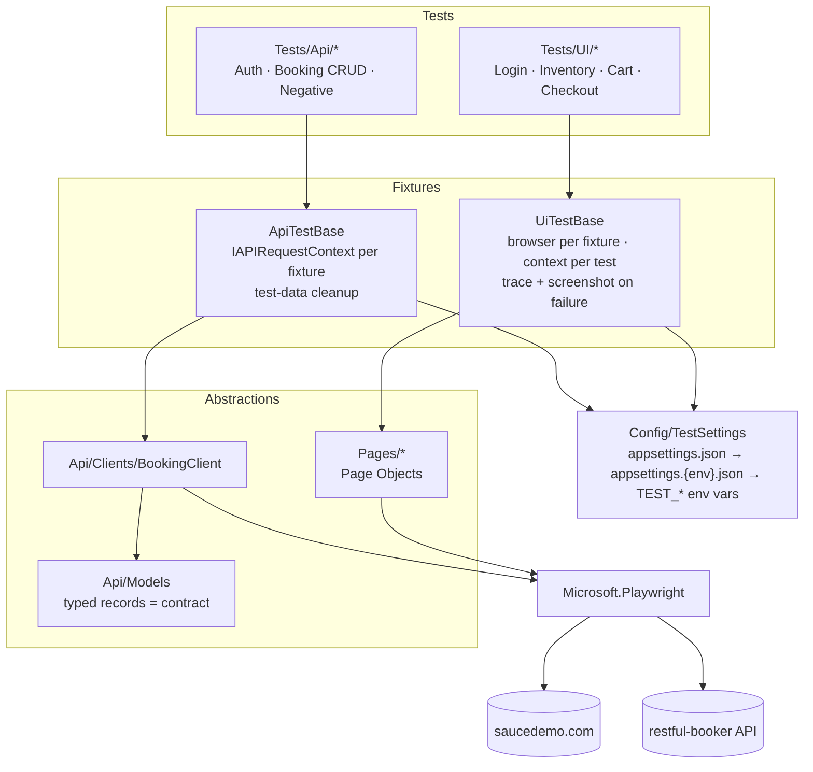

# .NET Playwright Test Framework

[](https://github.com/mustafaautomation/dotnet-playwright-framework/actions/workflows/ci.yml)
[](https://dotnet.microsoft.com)
[](https://playwright.dev/dotnet)
[](LICENSE)

A test automation framework in C# with UI tests and API tests in one project:

- **UI tests** run against [saucedemo.com](https://www.saucedemo.com) and use the Page Object Model with Playwright's auto-retrying assertions.
- **API tests** run against [restful-booker](https://restful-booker.herokuapp.com/apidoc/index.html) through Playwright's `IAPIRequestContext`, with typed models that also check the response shape.

Both layers share the same configuration, test categories, parallel runs, reporting and CI pipeline.

| Suite | Fixture | Tests | Covers |
|-------|---------|------:|--------|
| UI | `LoginTests` | 5 | valid login, locked-out / empty / wrong credentials (data-driven) |
| UI | `InventoryTests` | 7 | product grid, cart badge, sorting by name and price (order verified) |
| UI | `CartTests` | 4 | cart contents, empty cart, continue shopping, checkout entry |
| UI | `CheckoutTests` | 4 | end-to-end order with total = subtotal + tax, field validation |
| API | `AuthTests` | 2 | token creation, bad credentials |
| API | `BookingCrudTests` | 6 | create, read (contract), search, update, partial update, delete |
| API | `BookingNegativeTests` | 4 | unknown id, missing/invalid token, invalid payload |

---

## Architecture



## Folder layout

```
├── Api/
│   ├── Clients/BookingClient.cs   # one method per endpoint, returns IAPIResponse
│   ├── Models/                    # Booking, Auth records (also the response contract)
│   ├── ApiJson.cs                 # strict System.Text.Json options + ReadJsonAsync<T>()
│   └── BookingFactory.cs          # unique test data per test
├── Config/TestSettings.cs         # typed settings bound from configuration
├── Fixtures/
│   ├── UiTestBase.cs              # browser/context lifecycle, tracing, screenshots
│   └── ApiTestBase.cs             # request context, status helper, cleanup
├── Pages/                         # Login, Inventory, Cart, Checkout page objects
├── Tests/
│   ├── UI/{Auth,Cart,Checkout,Inventory}/
│   └── Api/Booking/
├── Utils/TestCategories.cs        # Smoke · Regression · UI · Api
├── AssemblyInfo.cs                # fixture-level parallelism
├── appsettings.json               # default settings
├── PlaywrightTests.runsettings    # worker count, trx + html loggers
├── Dockerfile
└── .github/workflows/ci.yml
```

---

## Running locally

Requirements: .NET 10 SDK and PowerShell (`pwsh`), which is needed for the Playwright install script.

```bash
dotnet build
pwsh bin/Debug/net10.0/playwright.ps1 install chromium   # add --with-deps on Linux

dotnet test                                    # everything
dotnet test --filter "Category=Api"            # API only, no browser needed
dotnet test --filter "Category=UI"             # UI only
dotnet test --filter "Category=Smoke"          # smoke across both layers
dotnet test --filter "Category=UI&Category=Regression"
```

Results go to `TestResults/`: `results.trx` and a standalone `report.html`.
When a UI test fails, a full-page screenshot and a Playwright trace are attached to that test's result. Open the trace with `pwsh bin/Debug/net10.0/playwright.ps1 show-trace <file>.trace.zip` or at [trace.playwright.dev](https://trace.playwright.dev).

### Configuration

Settings are read from `appsettings.json`, then from `appsettings.{TEST_ENVIRONMENT}.json` if that file exists, and then from environment variables with the `TEST_` prefix. Use `__` to reach a nested key:

| Setting | Default | Override example |
|---------|---------|------------------|
| `Ui:BaseUrl` | `https://www.saucedemo.com` | `TEST_Ui__BaseUrl=https://staging.example.com` |
| `Ui:Browser` | `chromium` | `TEST_Ui__Browser=firefox` (or `webkit`) |
| `Ui:Headless` | `true` | `TEST_Ui__Headless=false` |
| `Ui:TimeoutMs` | `10000` | `TEST_Ui__TimeoutMs=20000` |
| `Api:BaseUrl` | `https://restful-booker.herokuapp.com` | `TEST_Api__BaseUrl=...` |
| `Diagnostics:Tracing` | `RetainOnFailure` | `TEST_Diagnostics__Tracing=On` / `Off` |
| `Diagnostics:ScreenshotOnFailure` | `true` | `TEST_Diagnostics__ScreenshotOnFailure=false` |

The default credentials are the public demo accounts that both sites publish. Real credentials would come from environment variables or CI secrets instead.

Parallelism: fixtures run in parallel with 4 workers by default (`PlaywrightTests.runsettings`). To change the worker count for one run:

```bash
dotnet test -- NUnit.NumberOfTestWorkers=2
```

### Docker

The image is based on `mcr.microsoft.com/playwright/dotnet`, pinned to the same version as the NuGet package, so the browsers and OS dependencies are already installed.

```bash
docker build -t pw-dotnet .
docker run --rm pw-dotnet                                   # full suite
docker run --rm pw-dotnet --filter "Category=Smoke"         # args are passed to dotnet test
docker run --rm -e TEST_Ui__Browser=firefox \
  -v "$PWD/TestResults:/src/TestResults" pw-dotnet          # keep the reports
```

### CI

[`.github/workflows/ci.yml`](.github/workflows/ci.yml) runs on every push and pull request to `main`, and can also be started by hand (`workflow_dispatch`):

| Job | What it runs |
|-----|--------------|
| **API tests** | `Category=Api` |
| **UI tests (chromium, full)** | every `Category=UI` test |
| **UI tests (firefox, smoke)** | `Category=UI&Category=Smoke` (cross-browser check) |
| **Docker image (smoke)** | builds the image and runs `Category=Smoke` inside it |

Each job caches NuGet packages and writes a test summary to the run page using [GitHubActionsTestLogger](https://github.com/Tyrrrz/GitHubActionsTestLogger). Failures also show up as annotations. The `TestResults/` folder (trx, HTML report, failure screenshots and traces) is uploaded as an artifact.

---

## Design decisions

**Page Object Model, no assertions inside pages.** Page objects expose user actions (`LoginAsync`, `AddToCartAsync`) and the few locators that tests check (`ErrorMessage`, `CartBadge`). Tests assert with `Expect(locator)`. Those assertions retry until the timeout, so the tests have no sleeps or manual waits.

**Our own base fixture instead of `PageTest`.** `UiTestBase` launches one browser per fixture and creates a new `BrowserContext` for each test, so cookies and storage never leak between tests. Owning this lifecycle lets `TestSettings` choose the browser and headless mode, and lets us stop tracing with or without saving the file depending on the test outcome.

**API layer on Playwright's `IAPIRequestContext`.** This avoids a second HTTP stack. `BookingClient` returns the raw `IAPIResponse`, so a test can check a 403 or 404 as easily as a 200. Deserialization happens in the test with `ReadJsonAsync<T>()`.

**Typed models used as a contract check.** The records mark fields as `required`, and the serializer runs with `UnmappedMemberHandling.Disallow`. A missing field or an unexpected new field therefore fails with a clear message that includes the response body. We get most of the value of a JSON schema without maintaining a separate schema file.

**Self-contained test data.** restful-booker is a shared public sandbox that resets its data from time to time. Each API test creates its own booking with unique values from `BookingFactory`, never relies on existing data, and the fixture deletes what it created.

**Parallelism at fixture level.** Fixtures run in parallel, and tests inside a fixture run one after another. This keeps fixture state safe (one browser or request context per fixture) and still uses every worker. Test isolation comes from the context per test, not from execution order.

**Diagnostics only on failure by default.** Traces are recorded for every test but saved only when the test fails (`RetainOnFailure`), together with a screenshot. Passing runs stay fast and small, and a failing CI run gives you a trace you can replay step by step.

**Categories describe both layer and depth.** `UI`/`Api` are inherited from the base fixtures; `Smoke`/`Regression` are set on each test. CI combines them, for example running the full UI suite on Chromium but only the smoke tests on Firefox.

**Known API quirks are written down in the tests.** restful-booker returns HTTP 200 for bad credentials, 201 for a successful delete, and 500 for an invalid payload. The tests assert this actual behavior and say so in a comment, rather than asserting what a "correct" API would return.

---

## Tech stack

.NET 10 (LTS) · Playwright for .NET 1.64 · NUnit 5 · FluentAssertions 7 (kept on 7.x because 8.x needs a paid licence for commercial use) · Microsoft.Extensions.Configuration · GitHub Actions · Docker

## License

[MIT](LICENSE)
